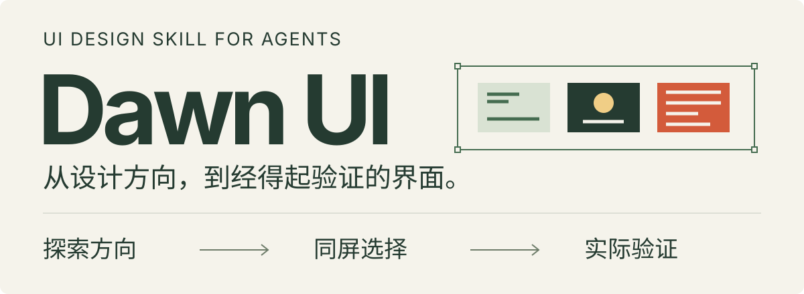
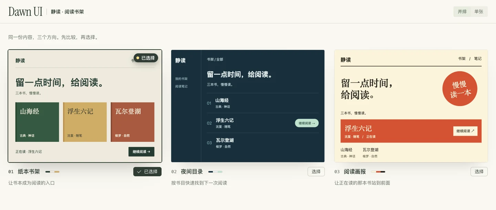

<p align="center">
  
</p>

# Dawn UI

给 AI Agent 的 UI 设计 Skill。设计网站、App、后台和组件：**先确定方向，再制作界面，最后用真实截图与操作结果改进。** 已有方向就直接深化，小改动直接完成。

## 先看方向，再做完整页面



上图由仓库内置生成器生成：同一份书目分别采用纸本书架、夜间目录和阅读画报三种布局，演示比较与选择。可以并排看、单张看、切换桌面和手机视口，选定后复制要求交给 Agent 继续。查看 [小样源码](assets/readme/demo) · [离线对比页](assets/readme/comparison.html)（下载后在浏览器打开）。

## 安装后，直接描述任务

```bash
npx skills add chenguang-jiang/dawn-ui
```

在支持 Skill 的 Agent 中使用，例如：

```text
用 dawn-ui 优化这个后台，保留品牌，重点改任务层级和失败状态，完成后验证。
```

想比较风格，就说“做三个首屏方向，放在同一页里让我选”；只想评审，就说“只给有实际证据的问题，不修改文件”。支持 Claude Code、Codex 等能够加载 Skill 的 Agent；实际制作与验收取决于宿主提供的工具。

## 不止默认状态

- **新界面**：从产品内容建立风格，处理字体、色彩、布局、素材与动效。
- **存量项目**：区分视觉改版、流程修复和新增功能，复用现有变量与组件。
- **交互与工作区**：覆盖表单、弹层、错误恢复、键盘焦点、窄屏布局，以及表格、队列、编辑器与画布的取舍。
- **组件与特效**：精修原位展开、抽屉和关键反馈；按需采用流光、点阵、渐变或 3D，并设计回退。
- **验证与评审**：检查真实操作、保存后读回、失败后输入保留与实际画面；需要精修时有限轮次迭代。

只要求设计稿或只读评审时，按该范围交付；没有看图或运行能力时，明确未验证项。不会自动接入付费服务、安装其他 Skill 或发布网站。[完整流程](skills/dawn-ui/SKILL.md) · [能力来源与限制](skills/dawn-ui/references/capabilities.md)

## 自带工具，按需使用

对比页、截图录屏与素材检索都是可选工具，已有项目继续使用原技术栈。[工具说明](skills/dawn-ui/references/tools.md) · [对比页输入格式](skills/dawn-ui/references/style-explorer.md)

<details>
<summary>命令、依赖与维护</summary>

```bash
# 生成自己的离线对比页
python3 skills/dawn-ui/scripts/build_explorer.py <任务目录>/manifest.json --output <任务目录>/comparison.html

# 截取实际页面
node skills/dawn-ui/scripts/shoot.mjs <页面或HTML文件> --size desktop --out <任务目录>/shots

# 检索素材，并按条目检查许可
node skills/dawn-ui/scripts/curate-media.mjs search "wood" --kind texture --limit 6
```

对比页生成器需 Python 3.10+ 标准库；截图和素材工具需 Node.js 22+。截图另需 Chrome、Chromium 或 Edge，录屏编码需 ffmpeg。工具不足时使用宿主能力，并说明未验证项。生成产物放任务目录，不放 Skill 安装目录。

复现上方对比页：

```bash
python3 skills/dawn-ui/scripts/build_explorer.py assets/readme/demo/manifest.json --output <任务目录>/comparison.html
```

工具回归：

```bash
python3 -m unittest discover -s skills/dawn-ui/tests -v
```

当前版本 **1.1.1**，开源基线为 Oil UI **v0.23.6**。上游变更手动合并，不联网检查版本，不自动覆盖安装。自动化回归验证工具契约，不保证每次生成设计的质量。

</details>

## 来源与许可

基于 [oil-oil/oil-ui](https://github.com/oil-oil/oil-ui) 的 MIT 开源内容，另有独立编写的交互、工作区、组件和特效实践。不包含 Oil UI Pro 私有文件，也不宣称与付费版等同。

[MIT](skills/dawn-ui/LICENSE) · [第三方声明](skills/dawn-ui/THIRD_PARTY_NOTICES.md)
